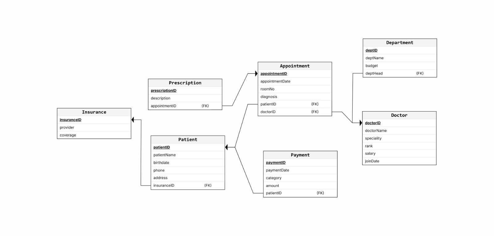

# Implementation Notes

## Project Information

### Application Name
Hospital Management System
---

# 1. Project Overview

This project implements a Hospital Management System using Oracle SQL and PL/SQL. The system manages patients, doctors, appointments, prescriptions, payments, insurance providers, and departments.

# 2. Implementation
The implementation demonstrates the use of:

- Records
- Collections
- Implicit Cursors
- Explicit Cursors
- Bulk Processing (BULK COLLECT and FORALL)
- Stored Procedures
- Functions
- Exception Handling

---

# 3. Database Schema

# 4. Performance 
I used BULK COLLECT and FORALL to retrieve payment info, process it, and update the payment table efficiently instead of using a traditional FOR loop, which, according to Claude AI, involves a lot of switching between the PL/SQL engine and the SQL engine.
